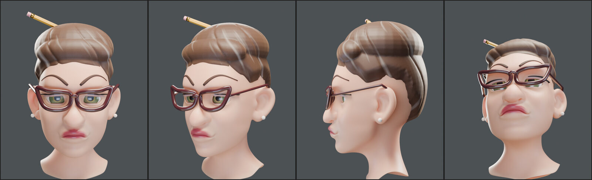
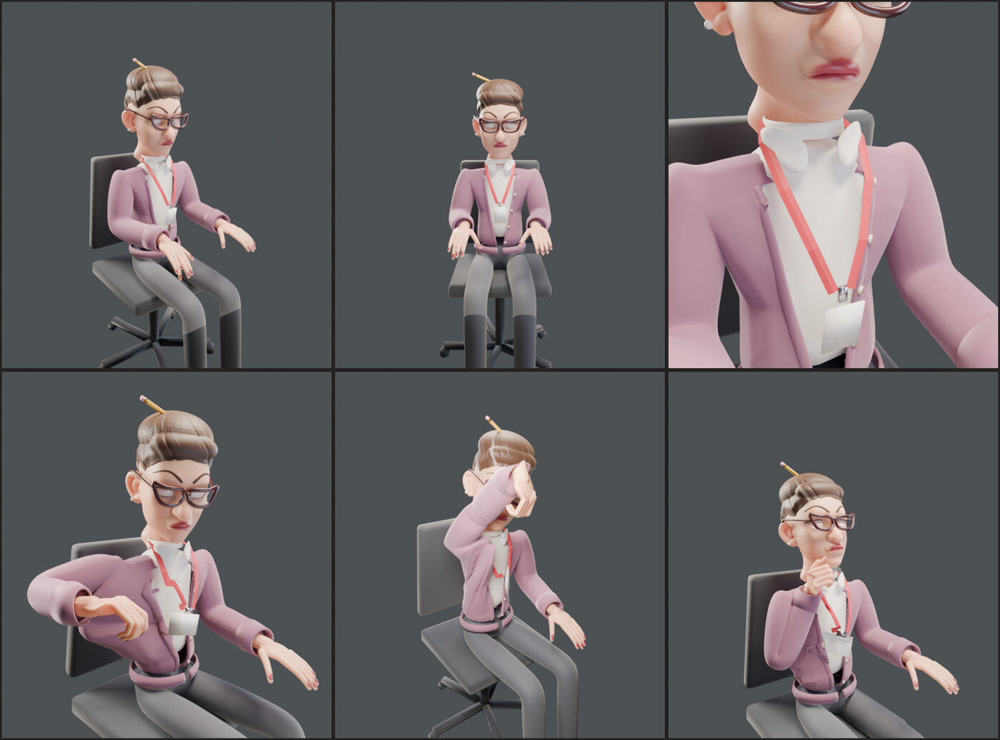

# Character lookdev — the giant office worker

A new, richer look for the characters: a **caricature built from strong, simple shapes**
(feature-animation style) with **PBR materials** that react to the office's light. The style is
defined on **one character first, the giant office worker**; the job-hunter players follow later
through a style guide. Local branch `feature/woman-lookdev` (never pushed).

*Style frame (L1, locked 2026-10-17): front, ¾, profile, and the view from the CV she reads.
Cycles render under an office-like light rig.*

## Style decisions

| Topic | Choice |
|---|---|
| Direction | Caricature: pushed proportions, bold smooth shapes, no anatomical micro-detail. Style references were three animated-film characters (used for style only; she is an original character) |
| Her | A **grumpy office clerk in her 40s–50s**: heavy droopy upper lids, sour pout with down-turned corners, round bulbous nose, jowls, thin plucked arched brows pulled down at the inner ends |
| Head size | ~1/5 of her height; arms keep their length so her clips still reach the CV, the mug and the shredder |
| Body | Thin and bony |
| Hair | Teased updo / low, wide mini beehive with a bouffant roll over the forehead, broad swept locks, brown with thin grey streaks, matte (a hint of hairspray shine); a yellow pencil stuck through it |
| Glasses | Thick burgundy cat-eye frames |
| Details | Pearl stud earrings, mauve eyeshadow, berry lipstick, green-hazel eyes |
| Outfit | Kept, more detailed: chunky mauve knit cardigan, white collared blouse, grey trousers, red lanyard + badge (L3) |
| Rejected | A realistic base head nudged towards cartoon: read as "not human", too anatomical |

## How the head is built (Blender, `blender_src/`, not committed)

- Base: Blender Studio's CC0 **Human Base Meshes** bundle, "Head - Stylized"
  (`blender_src/human-base-meshes-bundle-v1.4.1/`).
- `scripts/lookdev_clerk.py`: loads the base head, caricatures it with landmark-driven soft
  deformations (`caricature()`: eye openings, brows, nose + bulbous tip, mouth, sagging cheeks,
  nasolabial folds, eye bags, longer lower face, jowls, neck), its own **eyeballs** (procedural iris,
  glossy coat) and **eyelids as separate shells** over the eyes (heavy upper lids; ready for blink
  shape keys), skin with colour masks (lips, warmth).
- `scripts/clerk_parts.py`: the hair (scalp cap that sinks under the skin below the hairline, so
  the hairline is a clean line, + beehive dome + front roll, voxel-remeshed into one mass and carved
  into swept locks; a `Flow` UV drives strand bands and grey streaks), pencil, brows, lashes,
  cat-eye glasses (Catmull-Rom outline), pearl earrings.
- `scripts/lookdev_common.py`: GPU Cycles, the office-like light rig (ceiling panel key, cool
  window fill, warm desk bounce, rim, monitor glow), turnaround cameras. Lookdev file:
  `blender_src/woman_lookdev.blend`; renders in `blender_src/renders/lookdev/`.

## Body and clothes (L3)

*L3 (2026-10-17): typing pose, front, chest close-up, reading the CV, feeding the shredder,
sipping coffee. The clips run on the unchanged 50-bone `Woman_Rig`.*

- `scripts/build_clerk_body.py` builds everything straight into the rig's seated rest pose (her
  local space: metres, Z up, facing +Y, origin under the chair): Skin-modifier garments (the
  cardigan is voxel-remeshed to clean the armpit folds, then cut with planes: straight open V,
  neckline, open hem), ribbed hem band and cuffs, a button band following the cut edge with five
  buttons, a blouse kept only where it shows plus a collar, trousers, ankles, low pumps and hands
  as voxel-remeshed capsules along the rig's finger bones (berry nails), lanyard + badge, the old
  chair (taken from the old mesh, rigid on `Root`).
- The head from `lookdev_clerk.py` goes onto the neck (eye line at 1.245 m, turned to face +Y),
  its neck flare trimmed under the collar; `caricature()` now also turns the neck into a clean
  column.
- **Weights**: one smooth distance field per bone (`w ~ 1/d^6`, 3 bones, left/right locked) shared
  by every layer of clothing, so the layers move together; the head parts are rigid on `Head`
  (the neck blends into `Neck` / `Chest`); the hands use the finger bones. Everything is joined
  into one skinned mesh `Clerk`.
- **Clips**: `scripts/anim_clerk.py` = `anim_woman.py` adapted to the big head: the CV is read
  further out to her right, and while she feeds the shredder she scoots closer (0.19 m), leans
  less and turns her head away (her elbow used to rise over the old, small head). Reach error
  ≤ 10 cm as before; the forearm stays ≥ 30 cm from the head centre.
- **Known for later**: ~371k triangles in lookdev (hair ~90k, hands ~53k, cardigan ~66k from the
  voxel remeshes) → decimation + normal-map bakes in L7 (budget 60–80k); seen from the shredder's
  side, her feeding arm passes in front of her face.

## Steps

| # | Step | Status |
|---|---|---|
| L0 | Branch, lookdev scene, "before" renders | ✅ |
| L1 | Style frame: the head (two rounds; the second direction approved) | ✅ |
| L2 | Head details: eyes, lids, lashes, brows, glasses, hair | mostly done in L1 |
| L3 | Body + clothes on the existing 50-bone rig (`Woman_Rig`), reweighted, clips checked | ✅ |
| L4 | PBR texture sets baked from the procedural materials (skin, knit, weave, twill, plastic) | next |
| L5 | In-game shading (`MeshPhysicalMaterial`, office env light, monitor glow, panel flicker) | |
| L6 | Blinks and expression shape keys in her clips | |
| L7 | Performance, LOD, phones; validation | |
| L8 | Docs + style guide for the players | |
